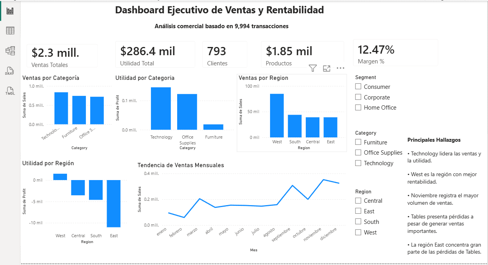
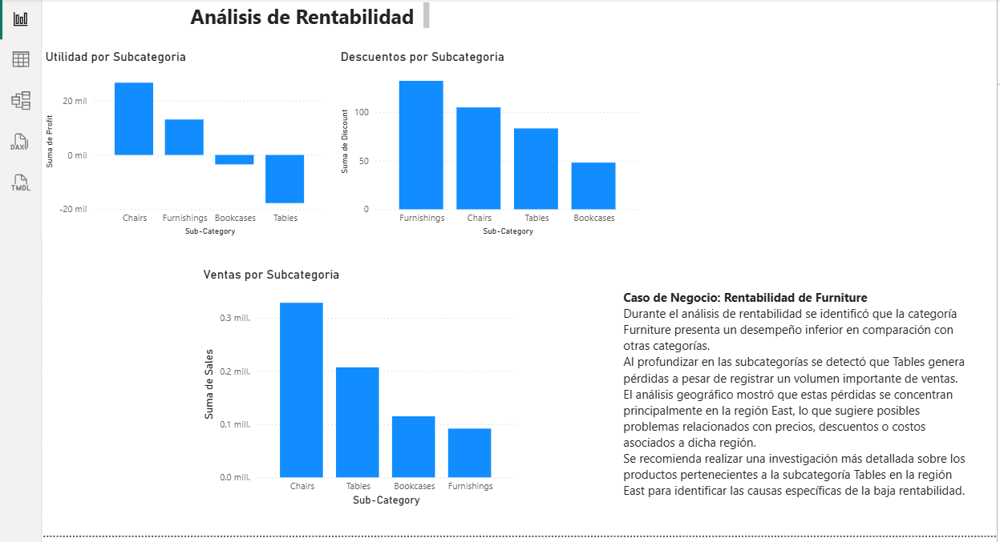

# Análisis de Ventas y Rentabilidad con Power BI

## Objetivo

Analizar el desempeño comercial y la rentabilidad de una empresa mediante Power BI para identificar tendencias de ventas, oportunidades de mejora y áreas con problemas de rentabilidad.

## Herramientas Utilizadas

- Power BI
- Power Query
- DAX
- Excel

## KPIs

- Ventas Totales
- Utilidad Total
- Margen %
- Clientes
- Productos

## Principales Hallazgos

- Technology lidera las ventas y la utilidad.
- West es la región con mejor rentabilidad.
- Noviembre registra el mayor volumen de ventas.
- Tables presenta pérdidas a pesar de generar ventas importantes.
- La región East concentra gran parte de las pérdidas de Tables.

## Dashboard Ejecutivo

## Análisis de Rentabilidad

## Recomendaciones

- Analizar la estrategia comercial de Tables.
- Investigar los factores que afectan la rentabilidad en East.
- Fortalecer la comercialización de productos Technology.
- Preparar estrategias para los meses de mayor demanda.
